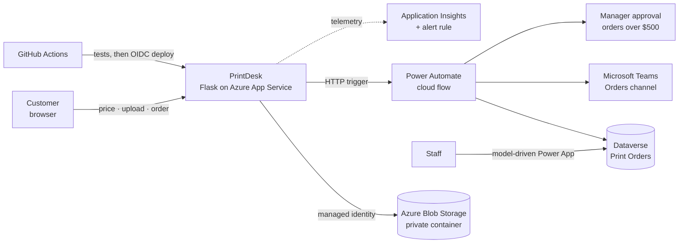

# PrintDesk

[](https://github.com/hub4murv/PrintDesk/actions/workflows/ci.yml)

**Self-serve online ordering for print shops.** Customers pick a product, choose options, see the price update live, upload their design and place the order, with no phone calls and no emailing files back and forth. Behind the scenes, every order is saved, routed for approval when needed and announced to staff in Microsoft Teams.

**Live demo:** <https://printdesk-oterez.azurewebsites.net>
(free hosting tier: the first visit can take ~20 seconds while the app wakes up)

> **Portfolio project.** PrintDesk is not a real print shop. All prices are demo values and no orders are fulfilled.

## How it works



1. The customer chooses options. The server calculates the price from the catalog (`POST /api/price`).
2. The design file is validated and stored in a **private Blob Storage container**. The app reaches storage with its **managed identity**, so there are no keys anywhere.
3. On **Place order**, the server recalculates the price (it never trusts the browser), creates an order ID and a short-lived, read-only link to the design, and sends everything to a **Power Automate** flow.
4. The flow answers `202 Accepted` right away and continues in the background: it posts the order to **Teams**, requests **manager approval** for orders over $500, and saves the result to **Dataverse**.
5. If anything fails (for example, nobody answers the approval within 3 days), a **try/catch** scope saves the order as *Needs review* and alerts Teams with a link to the failed run, so no order is lost silently.
6. Staff manage orders in a **model-driven Power App** on top of Dataverse.

## Engineering highlights

**Security**
- No secrets in code or settings for Azure access: the app uses a **system-assigned managed identity**, and storage account keys are **disabled**.
- **Least-privilege RBAC**: *Storage Blob Data Contributor* on one container, *Storage Blob Delegator* on the account. The deployment pipeline only has *Website Contributor* on this one web app.
- **Passwordless CI/CD**: GitHub Actions signs in to Azure with **OIDC** (workload identity federation), limited to this repository's `main` branch.
- Design links are **user delegation SAS** URLs: read-only, one file, HTTPS only, valid 6 days. Signed links are never written to logs.
- Upload validation: extension allow-list, magic-byte content check, ZIP/archive rejection, 50 MB limit, random storage keys (the customer's filename is never used as a path).
- Server-side pricing: the browser can't change what an order costs.

**Reliability**
- Asynchronous hand-off: the website never waits for an approval that can take days.
- Try/catch in the flow with an **out-of-band Teams alert** placed before the database write, and non-critical notifications configured so they can't break order processing (graceful degradation).
- Malformed input returns `400`, never a server error.

**Delivery and operations**
- **CI/CD**: every pull request runs the test suite; every merge to `main` deploys automatically, but only if the tests pass.
- **260+ automated tests** (pytest): every product page and price, catalog consistency checks (for example, the "from $X" label must equal the cheapest option), hostile input, upload spoofing and path traversal, signed-link tampering, and the order hand-off with a mocked flow and a fake Azure SDK.
- **Monitoring**: OpenTelemetry → Application Insights, KQL queries, and an alert rule that emails on failed requests. Log ingestion has a daily cap to protect the budget.
- **Data retention**: a lifecycle policy deletes customer designs after 90 days.

## Tech stack

| Area | Technology |
| --- | --- |
| Web app | Python 3.11, Flask, Jinja2, vanilla JavaScript |
| Hosting | Azure App Service (Linux) |
| Storage | Azure Blob Storage, `azure-identity`, `azure-storage-blob` |
| Workflow | Power Automate (HTTP trigger, approvals, try/catch, expressions) |
| Data and back office | Dataverse, Power Apps (model-driven) |
| Notifications | Microsoft Teams |
| Identity | Microsoft Entra ID: managed identity, app registration, federated credentials, RBAC |
| CI/CD | GitHub Actions, pytest |
| Observability | Application Insights, OpenTelemetry, Log Analytics (KQL), Azure Monitor alerts |

## Run locally

Requires Python 3.11+.

```bash
python -m venv .venv
# Windows (PowerShell):
.venv\Scripts\Activate.ps1
# macOS / Linux:
source .venv/bin/activate

pip install -r requirements-dev.txt
python -m pytest -q       # run the tests
python app.py             # http://127.0.0.1:5000
```

Locally, uploads go to `uploads_private/` and ordering is disabled until `FLOW_ORDER_URL` is set.

### Configuration (environment variables)

| Variable | Default | Purpose |
| --- | --- | --- |
| `FLASK_DEBUG` | off | Set to `1` to enable debug mode. Local development only. |
| `SECRET_KEY` | dev-only placeholder | Signs local download links. Set a real value for any deployment. |
| `STORAGE_BACKEND` | `local` | `local` (server disk, for development) or `azure` (Blob Storage). |
| `UPLOAD_DIR` | `uploads_private/` | Folder for uploads with the local backend. |
| `AZURE_STORAGE_ACCOUNT_URL` | none | Blob endpoint, e.g. `https://<account>.blob.core.windows.net`. Access uses managed identity, no keys. |
| `AZURE_STORAGE_CONTAINER` | `designs` | Private container for customer designs. |
| `FLOW_ORDER_URL` | none | Power Automate HTTP trigger URL. Secret: treat it like a password. |
| `APPLICATIONINSIGHTS_CONNECTION_STRING` | none | Enables Application Insights monitoring. |

## Project structure

```
app.py                    Flask routes, pricing handlers, order hand-off
uploads.py                Upload validation and storage backends (local disk, Azure Blob)
products.json             Product catalog and demo pricing
templates/                Jinja2 templates (catalog, product page, icons)
static/                   CSS and product images
tests/                    pytest suite
.github/workflows/ci.yml  CI (tests on every PR) and CD (deploy on merge to main)
```

The Power Automate flow, Dataverse table and Power App live in a Power Platform environment and are not part of this repository.

## Known limitations and future work

- **Antivirus scanning** of uploads is not wired up yet. Plan: a blob-triggered Azure Function that scans each new design.
- **Expired design links**: links last 6 days. A staff page behind Entra ID sign-in could generate fresh links on demand.
- **Rate limiting** on upload and order endpoints, since the public demo is open to anyone.
- **Approval threshold** ($500) is defined in two places (the flow and the page). It should come from one source.
- **Infrastructure as code** (Bicep) instead of CLI commands, and exporting the flow as a Power Platform solution.
- **Payments** (Stripe Checkout in test mode).
- A **Copilot Studio agent** that answers price and order-status questions.
